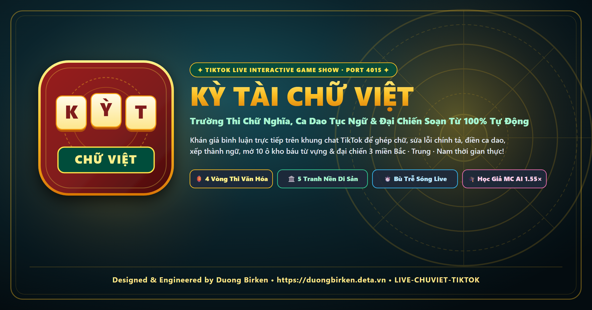
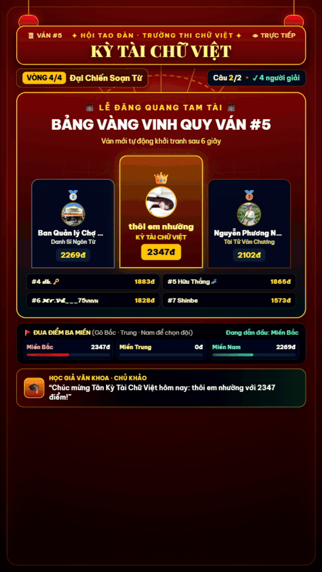
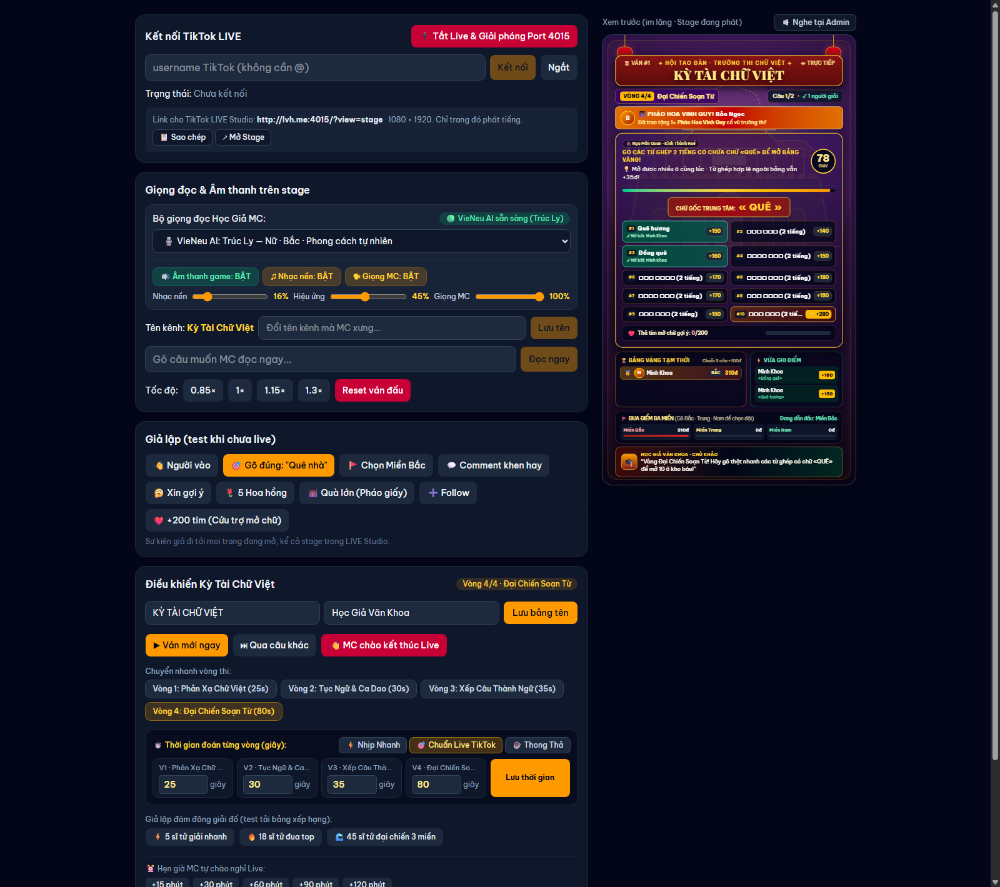
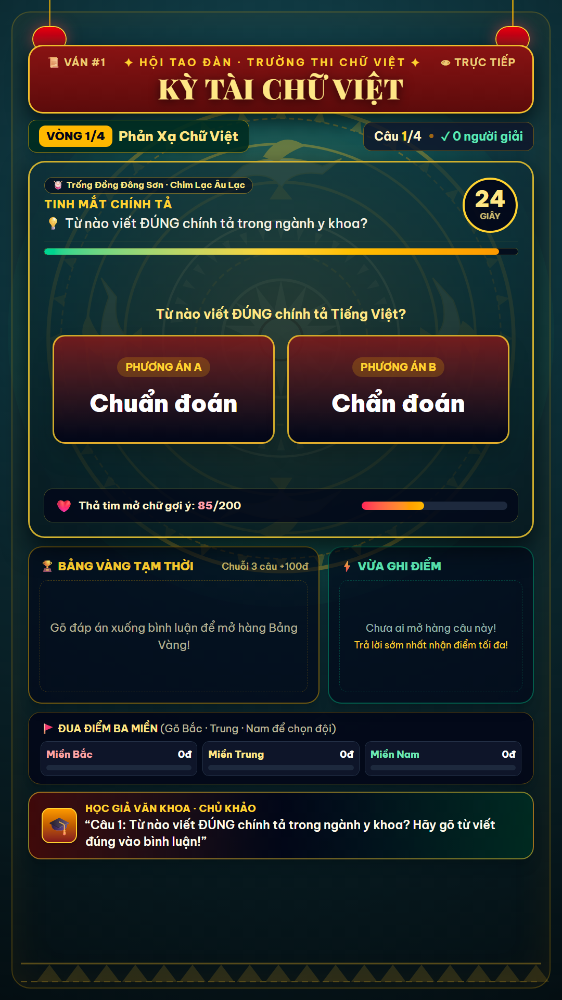
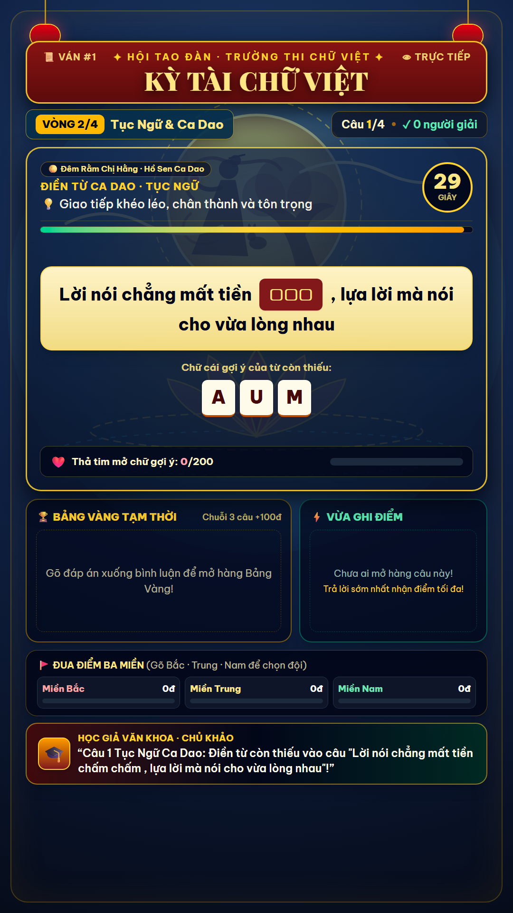
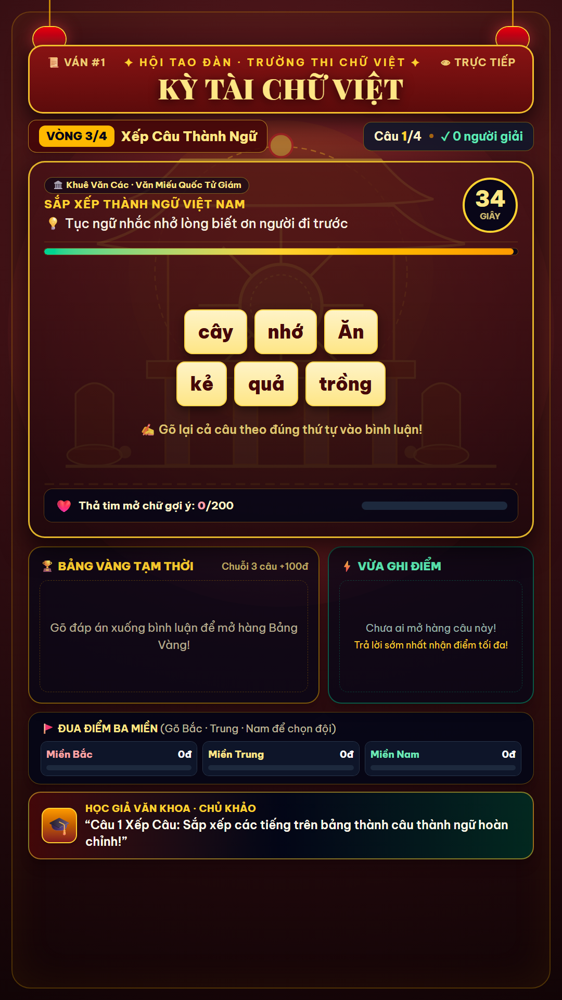
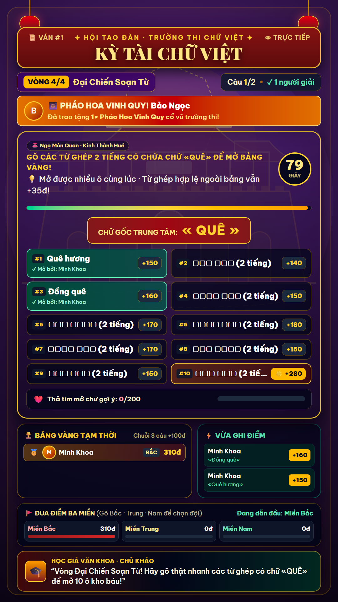

# 💿 Trạm Tải Bộ Cài Đặt Phần Mềm Thương Mại Chính Thức — Dương Birken (`birken-releases`)

  

> **Tác giả & Nhà phát triển:** **Dương Birken** — [https://duongbirken.deta.vn](https://duongbirken.deta.vn)  
> **Hỗ trợ kỹ thuật & Bảo hành bản quyền 1:1:** [Nhóm Zalo Team Support Dương Birken](https://zalo.me/g/gtzkglgazbwa8omcl1xw) · [Facebook Dương Birken](https://www.facebook.com/duongbirken)

Kho lưu trữ này là **Trạm Phân Phối Bộ Cài Đặt `.EXE` Chính Thức (Public Release Hub)** dành cho khách hàng sử dụng hệ sinh thái phần mềm thương mại của **Dương Birken**. Toàn bộ bộ cài đặt đã được tích hợp sẵn Runtime độc lập, tải về nhấp đúp **`1-Click`** là tự tạo biểu tượng ngoài màn hình Desktop và chạy ngay.

---

## 📦 Danh Sách Bộ Cài Đặt Chính Thức (`Windows 10 / 11 64-bit`)

| Phần mềm | Phiên bản | Chính sách Bản quyền | Link Tải Bộ Cài `.EXE` 1-Click & Trang Chủ |
| :--- | :---: | :--- | :--- |
| 🏮 **Kỳ Tài Chữ Việt Pro** *(Trường Thi Giải Đố Chữ Nghĩa, Ca Dao Tục Ngữ & Đại Chiến Soạn Từ TikTok LIVE `1080×1920`)* | **`v1.0.0`** | 🎁 **Dùng thử miễn phí 1 Ngày (`24h` · `0đ`)** 👑 **Mua đứt 1 lần duy nhất `99.000đ`** *(Vĩnh viễn theo máy · Mở khóa QR SePay 3s)* | 💿 **[Tải `Ky-Tai-Chu-Viet-Setup-v1.0.exe` (67.3 MB)](https://github.com/duongbirken2510/birken-releases/releases/download/chuviet-v1.0.0/Ky-Tai-Chu-Viet-Setup-v1.0.exe)** 🌐 [Trang giới thiệu & Tính năng](https://duongbirken.deta.vn/live-chu-viet) · 📖 [Cẩm nang HDSD A–Z](./docs/USER_GUIDE.md) |
| 🤖 **AI Livestream Studio Pro** *(Hệ Thống MC AI Livestream Bán Hàng Đa Sàn TikTok & Shopee Live 24/7)* | **`v1.2.7`** | 🎁 **Dùng thử miễn phí 3 Ngày (`72h` · `0đ`)** 👑 **Gói Tháng `99K` / Năm `499K` / Vĩnh viễn `680K`** *(Mở khóa QR SePay 3s)* | 💿 **[Tải `AI-Livestream-Studio-Pro-v1.2.7-Setup.exe` (134.8 MB)](https://github.com/duongbirken2510/birken-releases/releases/download/ailive-v1.2.7/AI-Livestream-Studio-Pro-v1.2.7-Setup.exe)** 🌐 [Trang giới thiệu & Tính năng](https://duongbirken.deta.vn/ai-livestream) · 📖 [Cẩm nang HDSD A–Z](https://duongbirken.deta.vn/ai-livestream/huong-dan) |

---

## 🏮 Chi Tiết Phiên Bản: Kỳ Tài Chữ Việt Pro (`v1.0.0`)

  
  
<i>▶️ Bấm vào hình động GIF bên trên để xem / tải bản <b><a href="./docs/media/kytaichuviet_demo_15s.mp4">Video Minh Họa Full HD 1080×1920 Có Âm Thanh & Giọng Học Giả MC</a></b></i>

### 👑 4 Quyền Lợi Vàng Khi Sở Hữu Bản Quyền Kỳ Tài Chữ Việt Pro (`99.000đ Mua Đứt 1 Lần`)
1. ✅ **Mua đứt 1 lần duy nhất `99.000đ`:** Quét mã VietQR SePay (`MBBank 537888686 - LE THAI BINH DUONG`) ngay trong ứng dụng (`/activate`), hệ thống tự động mở khóa vĩnh viễn theo thiết bị chỉ sau **3 giây**, cam kết không thu phí thuê bao hàng tháng.
2. ✅ **Cập nhật miễn phí trọn đời:** Tự động nhận ngân hàng đề văn hóa chữ Việt mới (`1.000+ câu hỏi & 2.600+ từ ghép`), tính năng mới và giọng đọc Học Giả MC AI mới.
3. ✅ **Hỗ trợ & Tặng kèm các Game TikTok LIVE miễn phí khác:** Được ưu tiên trải nghiệm và hỗ trợ hệ sinh thái các game tương tác TikTok LIVE khác của Dương Birken.
4. ✅ **Team Support hỗ trợ kỹ thuật 1:1 trực tiếp:** Hỗ trợ cài đặt OBS / TikTok LIVE Studio qua [Nhóm Zalo Team Support](https://zalo.me/g/gtzkglgazbwa8omcl1xw) & bảo hành cấp lại Key miễn phí theo SĐT Zalo khi cài lại Windows.

### 🖼️ Giao Diện Bàn Điều Khiển Admin & 4 Vòng Thi Di Sản Văn Hóa (`1080 × 1920`)

  

| 🥁 **Vòng 1: Phản Xạ Chữ Việt** *(Trống Đồng Đông Sơn & Chim Lạc)* | 🌕 **Vòng 2: Tục Ngữ & Ca Dao** *(Đêm Rằm Chị Hằng & Hồ Sen)* | 🏛️ **Vòng 3: Xếp Câu Thành Ngữ** *(Khuê Văn Các · Quốc Tử Giám)* | 🏯 **Vòng 4: Đại Chiến Soạn Từ** *(Ngọ Môn Quan · Kinh Thành Huế)* |
| :---: | :---: | :---: | :---: |
|  |  |  |  |

---

## 👨‍💻 Liên Hệ Tác Giả & Hỗ Trợ Kỹ Thuật

- **🌐 Website chính thức:** [**https://duongbirken.deta.vn**](https://duongbirken.deta.vn)
- **💬 Nhóm Zalo Team Support 1:1:** [**https://zalo.me/g/gtzkglgazbwa8omcl1xw**](https://zalo.me/g/gtzkglgazbwa8omcl1xw)
- **📘 Facebook cá nhân:** [**https://www.facebook.com/duongbirken**](https://www.facebook.com/duongbirken)
