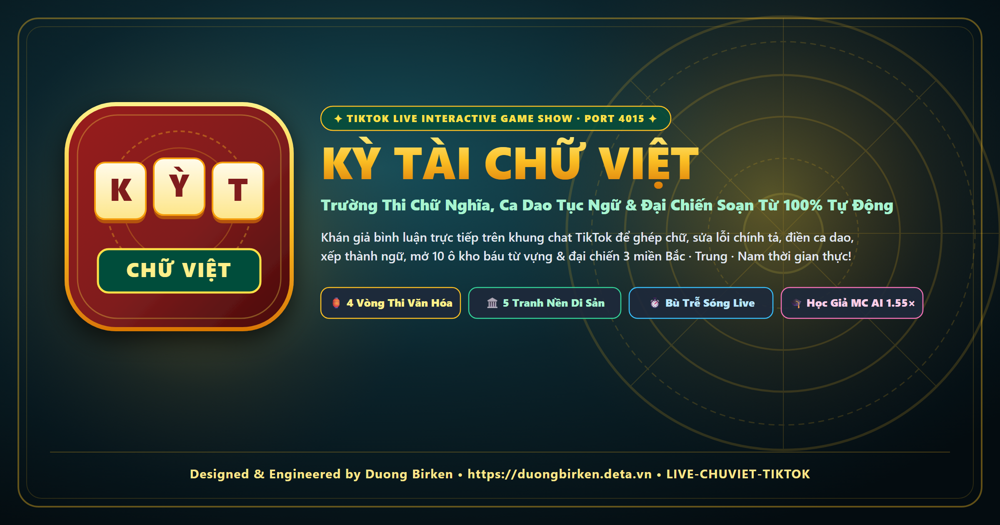
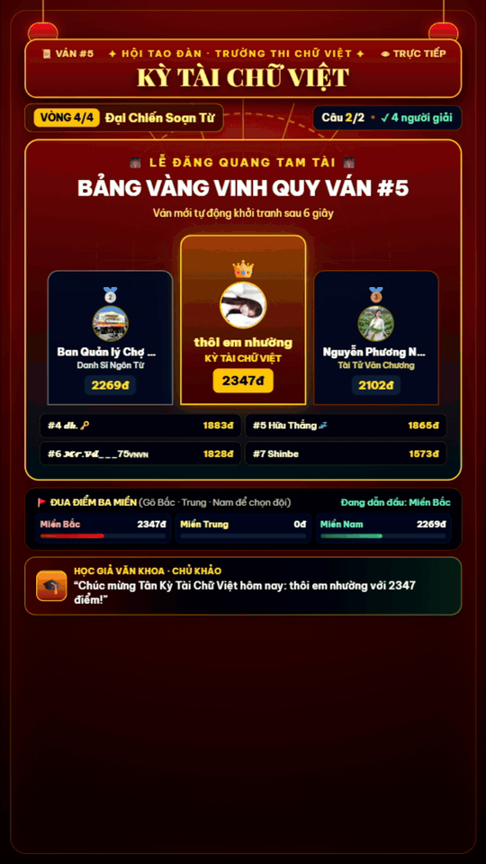
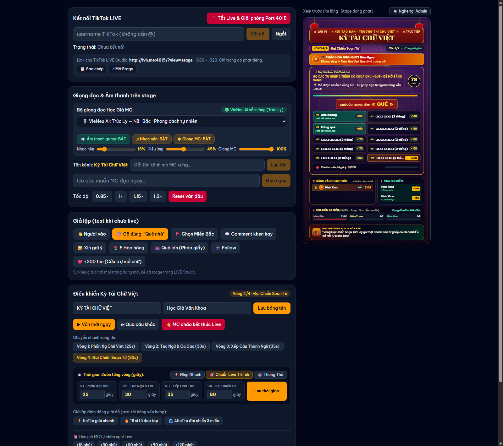
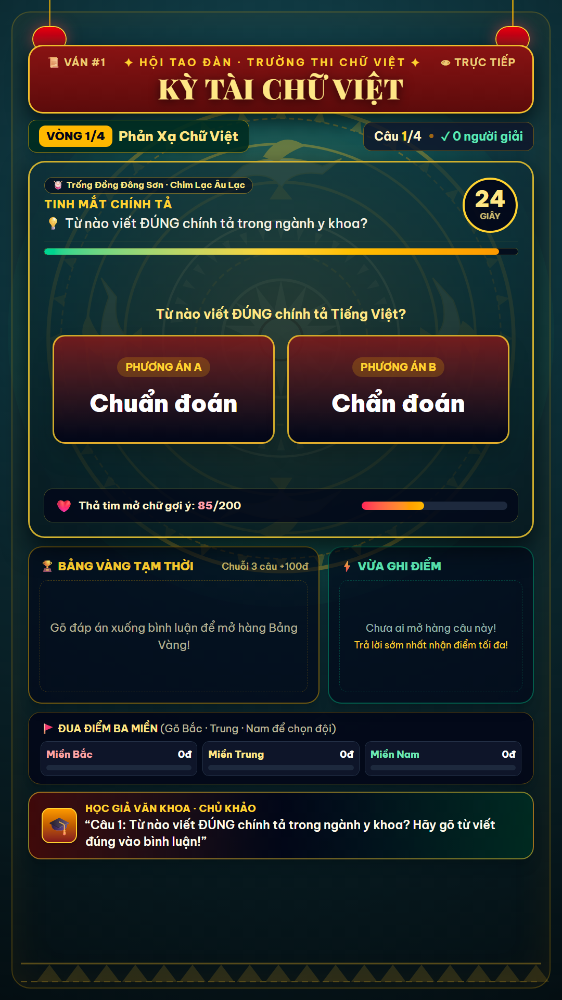
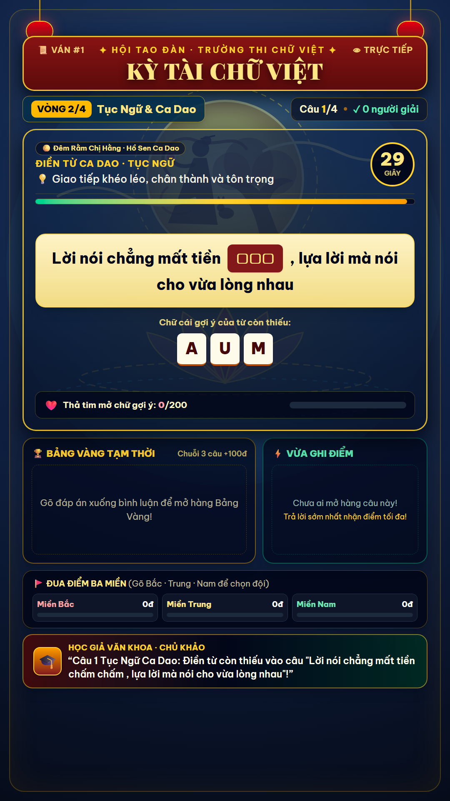
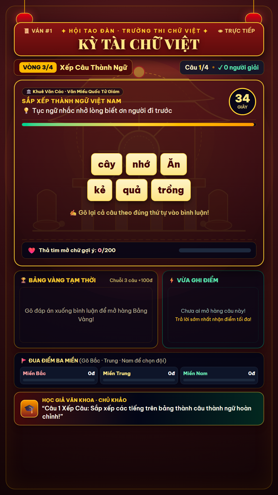
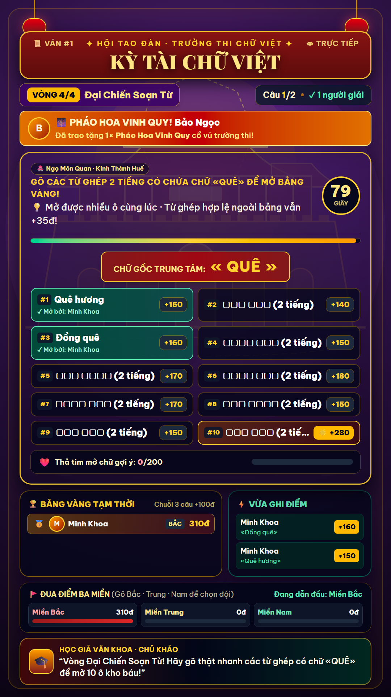

# 📖 CẨM NANG HƯỚNG DẪN SỬ DỤNG KỲ TÀI CHỮ VIỆT TOÀN TẬP (A–Z)
## Kỳ Tài Chữ Việt (`LIVE-CHUVIET-TIKTOK`) v1.0.0 — Bilingual User Guide (Tiếng Việt & English)

<div align="center">
  
  <br /><br />
  <a href="./media/kytaichuviet_demo_15s.mp4">
    
  </a>
  <p><i>▶️ <a href="./media/kytaichuviet_demo_15s.mp4"><b>Xem Video Minh Họa Thực Tế Sân Khấu Full HD (1080×1920 MP4 Có Âm Thanh)</b></a></i></p>
</div>

> **Tác giả / Author:** **Duong Birken** — [https://duongbirken.deta.vn](https://duongbirken.deta.vn)  
> **Kho mã nguồn chính thức / Official GitHub Repository:** [https://github.com/duongbirken2510/LIVE-CHUVIET-TIKTOK](https://github.com/duongbirken2510/LIVE-CHUVIET-TIKTOK)  
> **Hồ sơ Giới thiệu Sản phẩm & Công nghệ (10 Chương):** [`../info/Introduce_KyTaiChuViet.md`](../info/Introduce_KyTaiChuViet.md)  
> **Cổng vận hành mặc định / Default Ports:** Admin `http://localhost:4015` · TikTok LIVE Studio Stage `http://lvh.me:4015/?view=stage`

---

## 📑 Mục Lục Nhanh / Quick Navigation
- **Phần A — 🇻🇳 Hướng Dẫn Sử Dụng Tiếng Việt (Từ A đến Z)**
  1. [Bước 1: Khởi chạy nhanh 1-Click trên Windows & Dòng lệnh](#1-bước-1-khởi-chạy-nhanh-1-click-trên-windows--dòng-lệnh)
  2. [Bước 2: Đưa sân khấu 1080×1920 vào TikTok LIVE Studio / OBS & Kết nối phòng Live](#2-bước-2-đưa-sân-khấu-10801920-vào-tiktok-live-studio--obs--kết-nối-phòng-live)
  3. [Bước 3: Điều khiển 4 vòng thi, Bối cảnh văn hóa & Chỉnh thời gian đoán bù trễ sóng](#3-bước-3-điều-khiển-4-vòng-thi-bối-cảnh-văn-hóa--chỉnh-thời-gian-đoán-bù-trễ-sóng)
  4. [Bước 4: Cấu hình giọng đọc Học Giả MC AI & Bàn trộn âm thanh 3 kênh](#4-bước-4-cấu-hình-giọng-đọc-học-giả-mc-ai--bàn-trộn-âm-thanh-3-kênh)
  5. [Bước 5: Quản lý dữ liệu Bảng Vàng Tuần, Lịch sử câu hỏi & Cài đặt](#5-bước-5-quản-lý-dữ-liệu-bảng-vàng-tuần-lịch-sử-câu-hỏi--cài-đặt)
  6. [Bước 6: Mẹo giữ chân người xem, An toàn chính sách TikTok & Xử lý sự cố](#6-bước-6-mẹo-giữ-chân-người-xem-an-toàn-chính-sách-tiktok--xử-lý-sự-cố)
- **Part B — 🇬🇧 English User Guide (Step-by-Step)**
  1. [Step 1: 1-Click Launch & Environment Setup](#step-1-1-click-launch--environment-setup)
  2. [Step 2: Adding the 1080×1920 Stage to TikTok LIVE Studio / OBS](#step-2-adding-the-10801920-stage-to-tiktok-live-studio--obs)
  3. [Step 3: Customizing Round Timers, Audio Mixer & AI MC Voice](#step-3-customizing-round-timers-audio-mixer--ai-mc-voice)
  4. [Step 4: Data Management & Troubleshooting](#step-4-data-management--troubleshooting)

---

# 🇻🇳 PHẦN A — HƯỚNG DẪN SỬ DỤNG TIẾNG VIỆT (TỪ A ĐẾN Z)

## 1. Bước 1: Khởi chạy nhanh 1-Click trên Windows & Dòng lệnh

### 💿 A. Cài đặt bằng Bộ Cài `.EXE` 1-Click (Khuyên dùng cho người không rành GitHub / Node.js)
1. Tải file cài đặt duy nhất: **[`Ky-Tai-Chu-Viet-Setup-v1.0.exe`](https://github.com/duongbirken2510/LIVE-CHUVIET-TIKTOK/releases/latest/download/Ky-Tai-Chu-Viet-Setup-v1.0.exe)** từ trang **[GitHub Releases](https://github.com/duongbirken2510/LIVE-CHUVIET-TIKTOK/releases/latest)**.
2. Nhấp đúp mở `Ky-Tai-Chu-Viet-Setup-v1.0.exe`:
   - Nếu Windows hiện bảng xanh *Windows protected your PC (SmartScreen)*: bấm vào chữ **More info** (*Thông tin thêm*) ➔ bấm **Run anyway** (*Vẫn chạy*).
3. Bấm nút **`🚀 CÀI ĐẶT NGAY (1-CLICK)`**:
   - Bộ cài đặt đã nhúng sẵn toàn bộ Node.js Runtime và thư viện, sẽ tự động giải nén, **tạo biểu tượng `Kỳ Tài Chữ Việt - TikTok LIVE` ngoài màn hình Desktop** và mở ngay trang Quản trị Admin tại `http://localhost:4015`!
4. Những lần sử dụng sau, bạn chỉ cần nhấp đúp vào biểu tượng **`Kỳ Tài Chữ Việt - TikTok LIVE`** ngoài Desktop (hoặc file **`Ky-Tai-Chu-Viet.exe`** trong thư mục dự án).

### 💻 B. Khởi chạy từ thư mục mã nguồn bằng file `.bat` trên Windows 10 / 11
1. Mở thư mục dự án `LIVE-CHUVIET-TIKTOK`.
2. Nhấp đúp chuột vào file **[`BAT-LIVE.bat`](../BAT-LIVE.bat)**:
   - Nếu chạy lần đầu tiên, hệ thống sẽ tự động cài đặt thư viện (`npm install`).
   - Hệ thống tự động khởi chạy Server trên cổng **`4015`** và mở sẵn trang Quản trị Admin tại địa chỉ: **`http://localhost:4015`**.
   - Nếu Windows hiện bảng xanh *Windows protected your PC (SmartScreen)*: bấm vào chữ **More info** (*Thông tin thêm*) ➔ bấm **Run anyway** (*Vẫn chạy*).
3. Khi kết thúc buổi Live và muốn tắt hoàn toàn Server để giải phóng cổng `4015`:
   - **Cách 1 (Ngay trên trình duyệt):** Bấm nút màu đỏ **🔌 Tắt Server (Port 4015)** ở góc trên cùng bên phải trang Admin.
   - **Cách 2 (Bằng file tắt nhanh):** Nhấp đúp vào file **[`TAT-LIVE.bat`](../TAT-LIVE.bat)**.

### ⌨️ B. Khởi chạy bằng Terminal (Windows / macOS / Linux)
```bash
# Cài đặt thư viện (chỉ cần chạy lần đầu)
npm install

# Khởi chạy Server + Giao diện Admin & Stage trên cổng 4015
npm run dev

# Kiểm tra lỗi kiểu TypeScript & Chạy bộ 15 bài kiểm thử tự động
npm run lint
npm test
```

---

## 2. Bước 2: Đưa sân khấu 1080×1920 vào TikTok LIVE Studio / OBS & Kết nối phòng Live



### 🎬 A. Thêm màn hình Sân khấu vào TikTok LIVE Studio (hoặc OBS Studio)
1. Tại trang Quản trị Admin (`http://localhost:4015`), nhìn lên thanh công cụ trên cùng và bấm nút **📋 Copy link LIVE Studio** (đường dẫn được sao chép là: `http://lvh.me:4015/?view=stage`).
2. Mở phần mềm **TikTok LIVE Studio** (chế độ màn hình dọc `9:16`):
   - Bấm **Thêm nguồn (Add Source)** ➔ chọn **Liên kết (Link / Browser Source)**.
   - Dán đường dẫn: **`http://lvh.me:4015/?view=stage`**.
   - Đặt độ phân giải khung hình: Chiều rộng **`1080`** × Chiều cao **`1920`**.
   - *(Lưu ý: Dùng tên miền `lvh.me` thay cho `localhost` giúp vượt qua bộ lọc chặn nhập `localhost` của TikTok LIVE Studio trong khi vẫn trỏ thẳng về `127.0.0.1` trên máy của bạn).*

### 🔗 B. Kết nối bình luận thực tế từ phòng TikTok LIVE
1. Bấm nút **Phát trực tiếp (Go LIVE)** trên TikTok LIVE Studio trước.
2. Quay lại trang Admin (`http://localhost:4015`), ở khung **Kết nối TikTok LIVE** bên cột phải:
   - Nhập `@username` tài khoản TikTok đang phát trực tiếp (ví dụ: `chuviet.live`).
   - Bấm nút **Kết nối**.
   - Khi đèn trạng thái chuyển sang màu xanh **ĐANG LIVE**, toàn bộ bình luận, lượt thả tim, quà tặng và số mắt xem sẽ tự động chảy vào game!
   - Nếu mạng chập chờn, hệ thống có cơ chế **Tự động kết nối lại (Auto-Reconnect)** mà không làm mất điểm ván đang chơi.

---

## 3. Bước 3: Điều khiển 4 vòng thi, Bối cảnh văn hóa & Chỉnh thời gian đoán bù trễ sóng

### 🏮 A. Luật chơi & Bối cảnh văn hóa của 4 Vòng thi
Mỗi ván đấu gồm **4 vòng thi liên hoàn**, mỗi vòng mang một bức tranh nền di sản văn hóa Việt Nam riêng biệt:

| Vòng thi | Bối cảnh nền văn hóa | Nhiệm vụ của khán giả trên khung chat | Điểm thưởng |
| :--- | :--- | :--- | :--- |
| **Vòng 1 (4 câu)**<br>*Phản Xạ Chữ Việt* | 🥁 **Trống Đồng Đông Sơn & Chim Lạc Âu Lạc** | Ghép các chữ cái đảo vị trí thành từ đúng, hoặc chọn từ viết đúng chính tả giữa 2 phương án A/B. | `50đ – 120đ` (theo tốc độ) |
| **Vòng 2 (4 câu)**<br>*Tục Ngữ & Ca Dao* | 🌕 **Đêm Rằm Chị Hằng, Thỏ Ngọc & Hồ Sen** | Nhìn cuốn thư ca dao và dải chữ cái gợi ý để bình luận từ còn thiếu trong ô trống. | `80đ – 200đ` (theo tốc độ) |
| **Vòng 3 (4 câu)**<br>*Xếp Câu Thành Ngữ* | 🏛️ **Khuê Văn Các · Văn Miếu Quốc Tử Giám** | Sắp xếp các tiếng bị đảo vị trí trên bảng thành câu thành ngữ hoàn chỉnh. | `120đ – 300đ` (theo tốc độ) |
| **Vòng 4 (2 bảng)**<br>*Đại Chiến Soạn Từ* | 🏯 **Ngọ Môn Quan · Kinh Thành Huế** | Cho 1 chữ gốc trung tâm (*TÂM, TÌNH, QUÊ, NHÀ...*), bình luận thật nhiều từ ghép 2 tiếng có chứa chữ gốc để lật mở **10 ô kho báu** (ô Hoàng Kim `+280đ`, từ hợp lệ ngoài bảng vẫn nhận `+35đ`). | `140đ – 280đ`/ô (+`35đ` từ thưởng) |

#### 🖼️ Hình Ảnh Thực Tế 4 Vòng Thi Trên Sân Khấu `1080 × 1920`:

| 🥁 **Vòng 1: Phản Xạ Chữ Việt**<br>*(Trống Đồng Đông Sơn & Chim Lạc)* | 🌕 **Vòng 2: Tục Ngữ & Ca Dao**<br>*(Đêm Rằm Chị Hằng & Hồ Sen)* | 🏛️ **Vòng 3: Xếp Câu Thành Ngữ**<br>*(Khuê Văn Các · Quốc Tử Giám)* | 🏯 **Vòng 4: Đại Chiến Soạn Từ**<br>*(Ngọ Môn Quan · Kinh Thành Huế)* |
| :---: | :---: | :---: | :---: |
|  |  |  |  |

### ⏱️ B. Cách chỉnh Thời gian đoán từng vòng (Bù độ trễ sóng TikTok LIVE)
Ngay trong khung **Điều khiển Kỳ Tài Chữ Việt** trên trang Admin, mục **⏱️ Thời gian đoán từng vòng (giây)** cho phép bạn đổi thời lượng đếm ngược bất kỳ lúc nào:
1. **Chọn nhanh bằng 1 cú nhấp chuột (3 chế độ chuẩn hóa):**
   - **⚡ Nhịp Nhanh (`18s · 22s · 25s · 65s`):** Phù hợp khi bạn đang tự bấm test nhanh trên máy hoặc phòng live rất đông cao thủ.
   - **🎯 Chuẩn Live TikTok (`25s · 30s · 35s · 80s` — Khuyên dùng):** Đã cộng bù 5–10 giây độ trễ hình ảnh của TikTok LIVE để khán giả xem trên điện thoại có đủ thời gian nhìn đề và gõ tiếng Việt có dấu.
   - **☕ Thong Thả (`32s · 38s · 45s · 95s`):** Phù hợp khi phòng mới mở hoặc muốn khán giả vừa trò chuyện vừa suy nghĩ thư thả.
2. **Tự nhập số giây riêng cho từng vòng:**
   - Nhập số giây mong muốn (từ `5` đến `300` giây) vào 4 ô **V1 · V2 · V3 · V4** rồi bấm nút vàng **Lưu thời gian**.
   - Thời gian mới sẽ được áp dụng ngay lập tức lên đồng hồ sân khấu và lưu vào `settings.json` cho các lần mở máy sau.

---

## 4. Bước 4: Cấu hình giọng đọc Học Giả MC AI & Bàn trộn âm thanh 3 kênh

1. **Quy tắc chống vọng tiếng (Anti-Echo):**
   - Mặc định chỉ có màn hình Sân khấu (`?view=stage` trong TikTok LIVE Studio) phát ra âm thanh để khán giả không bị nghe tiếng vang đôi.
   - Nếu bạn chưa mở tab Stage hoặc muốn nghe thử ngay trên trang Admin, bấm nút **🔈 Nghe tại Admin: TẮT** để bật sang **🔊 Nghe tại Admin: BẬT**.
2. **Bàn trộn 3 kênh âm thanh độc lập:**
   - **🎵 Nhạc nền (`Music`):** Nhạc ngũ cung trường thi êm dịu, tự động hạ nhỏ 95% (**Pre-Ducking**) mỗi khi Học Giả MC cất tiếng nói.
   - **🔔 Hiệu ứng (`SFX`):** Tiếng trống khai trường, tiếng chiêng mở đáp án, tiếng mõ gõ 5 giây cuối và pháo hoa đăng quang.
   - **🗣️ Giọng MC (`Voice`):** Tự động được khuếch đại **`1.55×`** để lời đọc câu hỏi và vinh danh sĩ tử luôn rõ nét nhất.
3. **Đổi bảng tên Hoành Phi & Danh xưng Học Giả MC:**
   - Nhập tên bảng hoành phi (VD: `KỲ TÀI CHỮ VIỆT`) và tên MC (VD: `Học Giả Văn Khoa`) vào 2 ô đầu bảng điều khiển rồi bấm **Lưu bảng tên**.

---

## 5. Bước 5: Quản lý dữ liệu Bảng Vàng Tuần, Lịch sử câu hỏi & Cài đặt

Toàn bộ dữ liệu vận hành được lưu gọn nhẹ bằng định dạng JSON ngay trong thư mục dự án (không chiếm dung lượng ổ C):
- **`settings.json`**: Lưu tên kênh, `@username` TikTok, tiêu đề hoành phi, danh xưng MC, thời gian 4 vòng thi (`thoiGianVong`), giọng đọc và mức âm lượng 3 kênh.
- **`data/bang-tuan.json`**: Lưu bảng xếp hạng tích lũy điểm của các sĩ tử trong tuần (tự động làm mới khi bước sang thứ Hai tuần mới).
- **`data/da-hoi.json`**: Lưu lịch sử các câu hỏi đã xuất hiện để ưu tiên bốc câu mới trong các ván tiếp theo.
- **Sao lưu / Chuyển máy:** Chỉ cần copy thư mục `data/` và file `settings.json` sang máy mới là giữ nguyên 100% cấu hình và bảng điểm tuần.

---

## 6. Bước 6: Mẹo giữ chân người xem, An toàn chính sách TikTok & Xử lý sự cố

### 💡 A. Mẹo tương tác & Giữ chân người xem trên TikTok LIVE
- **Kêu gọi chọn đội 3 miền:** Nhắc khán giả gõ `Bắc`, `Trung` hoặc `Nam` vào bình luận để đầu quân cho quê hương — thanh **🚩 Đua Điểm Ba Miền** dưới chân sân khấu sẽ tạo hiệu ứng thi đua cực mạnh.
- **Kêu gọi thả tim miễn phí mở gợi ý:** Khi gặp câu khó, nhắc cả phòng cùng chạm màn hình thả đủ **200 tim miễn phí** để thanh cứu trợ mở chữ cái đầu tiên.
- **Chế độ giả lập đám đông khi phòng mới mở:** Trên trang Admin có 3 nút **⚡ 5 sĩ tử giải nhanh**, **🔥 18 sĩ tử đua top**, **🌊 45 sĩ tử đại chiến 3 miền** để bạn kiểm tra hiệu ứng bảng vàng hoặc làm nóng sân khấu trước khi vào phiên chính.

### 🛠️ B. Xử lý sự cố thường gặp
- **Trình duyệt chặn phát âm thanh tự động:** Nếu trên đỉnh màn hình sân khấu hiện nút vàng **🔊 Chạm 1 lần để bật âm thanh trường thi**, bạn chỉ cần click chuột 1 lần vào khung hình sân khấu để mở khóa WebAudio.
- **Báo lỗi cổng 4015 đang bận (`EADDRINUSE`):** Nghĩa là Server đã được bật từ trước đó rồi (bạn có thể mở thẳng `http://localhost:4015`), hoặc chạy file `TAT-LIVE.bat` để giải phóng cổng rồi mở lại.

---

# 🇬🇧 PART B — ENGLISH USER GUIDE (STEP-BY-STEP)

## Step 1: 1-Click Launch & Environment Setup
- **Windows 10/11 (1-Click):** Double-click [`BAT-LIVE.bat`](../BAT-LIVE.bat) to automatically install dependencies (on first run), launch the server on port `4015`, and open the Admin Dashboard at `http://localhost:4015`. To stop the server and free port `4015`, click the red **🔌 Tắt Server (Port 4015)** button in the Admin header or double-click [`TAT-LIVE.bat`](../TAT-LIVE.bat).
- **Command Line (Windows / macOS / Linux):** Run `npm install` followed by `npm run dev`.

## Step 2: Adding the 1080×1920 Stage to TikTok LIVE Studio / OBS
1. On the Admin Dashboard (`http://localhost:4015`), click **📋 Copy link LIVE Studio** to copy `http://lvh.me:4015/?view=stage`.
2. In **TikTok LIVE Studio** or **OBS Studio**, add a **Link / Browser Source**, paste `http://lvh.me:4015/?view=stage`, and set the resolution to **`1080 × 1920`** (vertical 9:16).
3. Once your TikTok stream is live, enter your `@username` in the **Kết nối TikTok LIVE** panel on the Admin Dashboard and click **Kết nối**.

## Step 3: Customizing Round Timers, Audio Mixer & AI MC Voice
- **Round Guess Timers (`⏱️ Thời gian đoán từng vòng`):** Choose from 3 instant presets — **⚡ Fast (`18·22·25·65s`)**, **🎯 TikTok Live Standard (`25·30·35·80s` — recommended to compensate for 4–7s stream latency)**, or **☕ Relaxed (`32·38·45·95s`)** — or enter custom seconds (`5–300s`) for each of the 4 rounds and click **Lưu thời gian**.
- **3-Channel Audio Mixer:** Independently adjust Background Music, SFX, and AI MC Voice volumes. Background music automatically ducks by 95% whenever the AI MC speaks, while the MC voice is boosted by `1.55×`.

## Step 4: Data Management & Troubleshooting
- All settings and weekly leaderboards are stored locally in `settings.json`, `data/bang-tuan.json`, and `data/da-hoi.json`.
- Run `npm run lint` and `npm test` at any time to execute the 15 automated verification checks.

---

## 👨‍💻 Tác Giả & Liên Hệ / Author & Contact

| 🇻🇳 Lời nhắn từ Tác giả | 🇬🇧 Note from the Author |
| :--- | :--- |
| **LIVE-CHUVIET-TIKTOK (`Kỳ Tài Chữ Việt`)** là dự án tâm huyết được phát triển bởi **Duong Birken**. Nếu dự án hữu ích với bạn, hãy tặng một ngôi sao (**⭐ Star**) trên GitHub hoặc ghé thăm website chính thức để kết nối, khám phá thêm các công cụ livestream tương tác tự động và góp ý nhé! | **LIVE-CHUVIET-TIKTOK (`Kỳ Tài Chữ Việt`)** is crafted with passion by **Duong Birken**. If you find this project helpful, please consider giving it a **⭐ Star** on GitHub or visiting the official website to connect and share your feedback! |

- **🌐 Website chính thức & Liên hệ tác giả:** [**https://duongbirken.deta.vn**](https://duongbirken.deta.vn)
- **🐙 GitHub Profile:** [**https://github.com/duongbirken2510**](https://github.com/duongbirken2510)
- **📦 Kho mã nguồn GitHub:** [**https://github.com/duongbirken2510/LIVE-CHUVIET-TIKTOK**](https://github.com/duongbirken2510/LIVE-CHUVIET-TIKTOK)
- **🏮 Hồ sơ Giới thiệu Sản phẩm & Công nghệ 10 Chương:** [**`../info/Introduce_KyTaiChuViet.md`**](../info/Introduce_KyTaiChuViet.md)
